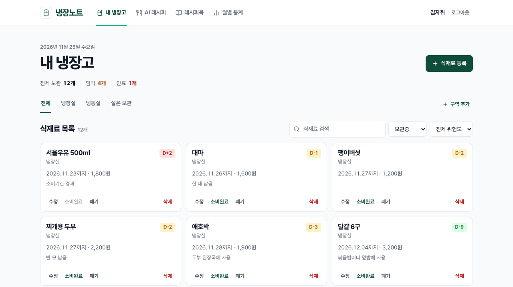
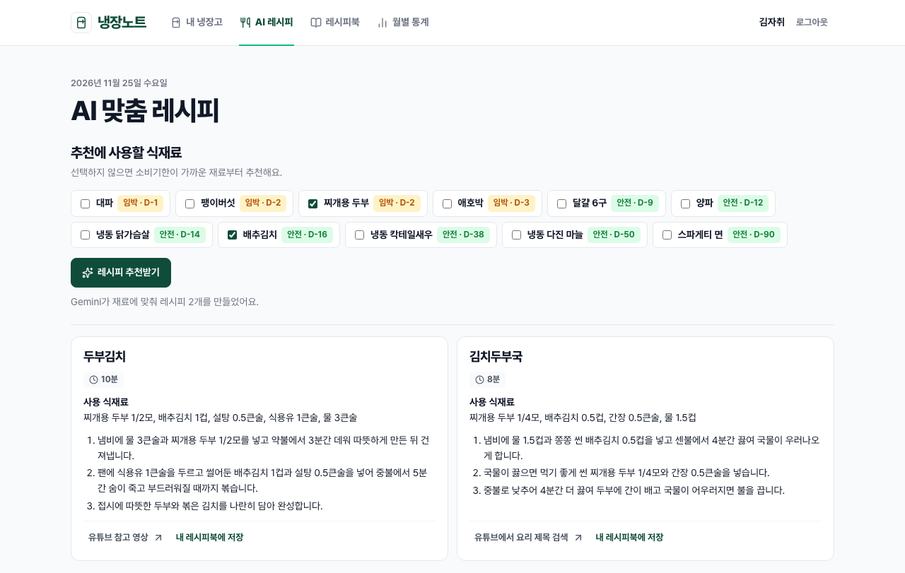
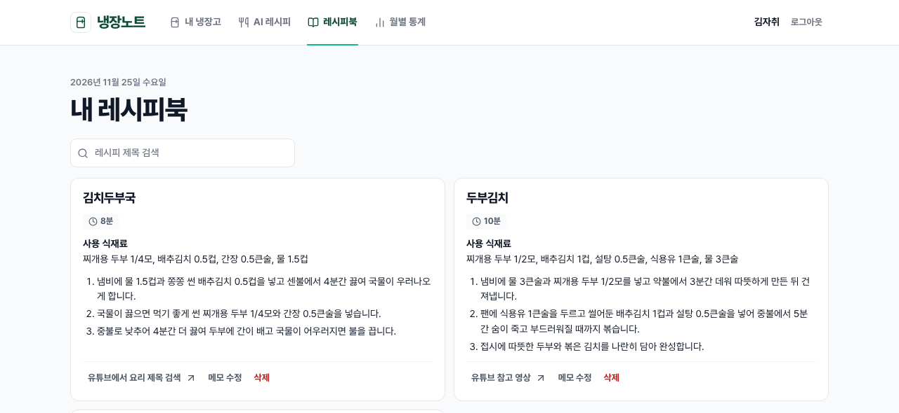
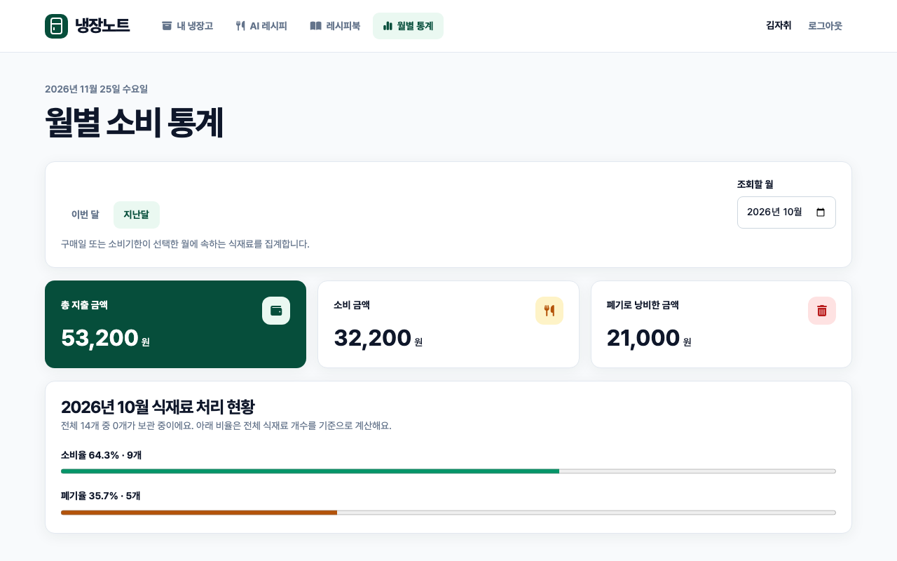

# 냉장노트

냉장고에 반 모 남은 두부, 언제까지 먹을 수 있고 오늘은 뭘 만들어 먹을까? **냉장노트**는 1인 가구가 소비기한이 가까운 재료부터 찾아 요리하고, 한 달 동안 어떤 식재료를 얼마나 버렸는지 돌아보는 웹앱입니다. 고급웹프로그래밍 기말 프로젝트로 만들었습니다.

[로컬 실행](#로컬-실행) · [화면 둘러보기](#화면-둘러보기) · [구현 살펴보기](#구현-살펴보기) · [API 검증](#api-검증)



## 로컬 실행

Node.js 24, npm, 연결 가능한 PostgreSQL 데이터베이스를 준비합니다. 로컬 PostgreSQL과 Supabase PostgreSQL을 사용할 수 있습니다.

### 1. 패키지 설치

GitHub에서 처음 내려받는 경우 아래 명령을 실행합니다. 이미 폴더를 복사했다면 그 안에서 `package.json`이 있는 위치로 이동해 `npm install`부터 실행합니다.

```bash
git clone https://github.com/JinseoHong0/fridge-manager.git
cd fridge-manager
npm install
```

이 단계에서 프로젝트에 지정한 **Prisma 7 CLI**도 함께 설치됩니다. `npx prisma` 명령은 설치가 끝난 뒤에 실행합니다. 잠금 파일의 버전으로 새로 설치하려면 `npm ci`도 사용할 수 있습니다.

### 2. 환경 변수 설정

프로젝트 루트에 `.env`가 없으면 예시 파일을 복사한 뒤 값을 채웁니다.

```bash
cp .env.example .env
```

| 변수 | 설정할 값 |
| --- | --- |
| `DATABASE_URL` | 사용할 PostgreSQL 연결 문자열. 처음 체험할 때는 초기화할 수 있는 개발용 DB를 지정합니다. |
| `SESSION_SECRET` | 로그인 세션 쿠키 서명에 사용할 임의의 긴 문자열 |
| `GEMINI_API_KEY` | Gemini 레시피 생성을 사용할 때 입력합니다. 키가 없거나 요청에 실패하면 선택한 재료로 만들 수 있는 기본 레시피를 찾습니다. |
| `PORT` | 서버 포트. 기본값은 `3000`입니다. |

### 3. Prisma Client 생성 및 서버 시작

새로 받은 폴더에는 생성된 Prisma Client가 포함되어 있지 않으므로 한 번 생성합니다.

```bash
npx prisma generate
```

**새 시연용 DB를 준비할 때** 아래 두 명령을 실행합니다. **`npm run reset`은 `DATABASE_URL`이 가리키는 DB의 기존 데이터를 삭제**하고 마이그레이션과 체험 데이터를 적용합니다. 프로젝트 폴더를 복사해도 연결 문자열이 같으면 같은 DB에 적용됩니다.

```bash
npm run reset
npm run dev
```

**이미 이 프로젝트의 스키마와 데이터가 있는 DB에 연결하거나 다음 날 다시 실행할 때**는 서버만 시작합니다.

```bash
npm run dev
```

브라우저에서 **체험 계정 A로 빠른 로그인**을 누르면 식재료가 채워진 냉장고가 열립니다. [로컬 앱 열기](http://localhost:3000)

| 시드 계정 | 이메일 | 비밀번호 | 용도 |
| --- | --- | --- | --- |
| A · 김자취 | `a@test.com` | `pass1234` | 냉장고, 추천 레시피, 이번 달·지난달 통계 시연 |
| B · 이자취 | `b@test.com` | `pass1234` | A의 식재료 수정 시 접근 거부 확인 |

## 화면 둘러보기

체험 계정 A에는 시드 생성 시점 기준으로 **보관 중인 식재료 12개**, **이번 달 소비·폐기 기록 9개**, **지난달 소비·폐기 기록 14개**가 들어 있습니다. 보관 중인 재료에는 이미 소비기한이 지난 우유도 포함됩니다.

| 화면 | 체험 계정으로 해 볼 일 |
| --- | --- |
| 내 냉장고 | 냉장실에서 `찌개용 두부`를 검색해 D-Day, 소비기한, 가격과 메모를 확인합니다. 만료된 `서울우유 500ml`에서는 소비완료 버튼이 비활성화됩니다. |
| AI 레시피 | 찌개용 두부와 배추김치를 고릅니다. 아래 시연에서는 Gemini가 **두부김치**와 **김치두부국**을 제안했습니다. 각 카드에서 조리 시간, 사용 재료, 단계별 조리법과 참고 영상을 확인합니다. |
| 레시피북 | 마음에 드는 추천을 저장하고 제목으로 다시 찾습니다. 개인 메모에 다음에 바꿔 볼 양념이나 조리 시간을 적을 수 있습니다. |
| 월별 통계 | **지난달**을 누르면 미리 넣어 둔 폐기 기록 5건의 합계 **21,000원**을 확인할 수 있습니다. 폐기 금액이 가장 컸던 재료는 **손질 오징어(6,900원)**입니다. |

<details>
<summary>AI 레시피 추천 화면</summary>



</details>

<details>
<summary>레시피북 화면</summary>



</details>

<details>
<summary>월별 소비 통계 화면</summary>



</details>

## 구현 살펴보기

**소비기한과 처리 상태.** 보관 중(`ACTIVE`)이어도 소비기한이 지나면 만료(`EXPIRED`)입니다. 서버는 날짜를 기준으로 당일부터 3일 남은 재료를 임박으로, 4일 이상 남은 재료를 안전으로 분류합니다. 만료된 재료의 소비완료 요청은 서버에서도 `400`으로 거부하며, 폐기는 기록할 수 있습니다. [D-Day 계산](src/utils/dday.ts) · [상태 변경 처리](src/controllers/ingredientController.ts)

**추천 재료와 영상 선택.** 서버는 사용자가 보관 중인 재료에서 만료 항목을 먼저 제외합니다. 재료를 고르지 않으면 소비기한이 가까운 순서로 최대 5개를 사용합니다. Gemini가 만든 요리 두 개의 제목으로 유튜브를 각각 검색하고, 같은 영상 ID는 한 번만 배정합니다. 영상 검색이 지연되면 해당 제목의 검색 결과를 열 수 있습니다. 추천 응답의 `source`와 화면 안내에서 Gemini 생성(`ai`)과 기본 추천(`fallback`)을 구분할 수 있습니다. Gemini를 이용할 수 없을 때는 필요한 주재료가 모두 있는 기본 레시피를 최대 두 개 고릅니다. 일치하는 요리가 없으면 재료 변경 또는 재시도를 안내합니다. [추천 컨트롤러](src/controllers/recipeController.ts)

**월별 통계의 기준.** 구매일 또는 소비기한이 선택한 달에 들어오는 재료를 조회 시점의 상태로 집계합니다. 두 날짜가 서로 다른 달이면 양쪽 월에 포함될 수 있습니다. 소비율·폐기율은 **건수** 기준이고, 도넛 차트는 **금액** 기준입니다. 화면에서는 전월 대비 총지출과 폐기액, 폐기 금액 상위 5개, 구역별 지출과 폐기 건수를 함께 보여줍니다. 폐기액은 아메리카노 한 잔(4,500원) 값으로도 환산합니다. [서버 집계](src/controllers/ingredientController.ts) · [대시보드 렌더링](public/app.js)

### 코드 구조

Express 한 프로세스가 HTML·CSS·JavaScript와 JSON API를 함께 제공합니다. 화면에서 식재료의 **폐기**를 누르면 다음 순서로 처리됩니다.

```text
public/app.js                        PATCH /ingredients/:id/status 요청
  → src/routes/ingredientRouter.ts   로그인 세션 확인 및 요청 연결
  → src/controllers/ingredientController.ts   대상·소유자·상태 검증
  → src/stores/ingredientStore.ts    Prisma로 PostgreSQL의 식재료 상태 갱신
```

| 영역 | 기술과 역할 |
| --- | --- |
| 화면 | HTML, CSS, Vanilla JS로 목록·모달·검색을 구현하고 Chart.js로 월별 지출을 시각화합니다. |
| 서버 | Node.js, Express 5, TypeScript(ESM)를 사용합니다. 라우터, 요청 검증, DB 접근을 분리합니다. |
| 인증 | 회원가입 시 bcrypt로 비밀번호를 해시합니다. Passport Local로 로그인하면 세션에는 사용자 ID를 저장하고, 다음 요청에서 사용자를 복원합니다. [회원가입](src/controllers/authController.ts) · [세션 인증](src/passport.ts) |
| 데이터 | Prisma 7과 PostgreSQL을 사용합니다. 사용자는 보관 구역·식재료·저장한 레시피를 소유하며, 각 식재료는 하나의 보관 구역에 속합니다. [데이터 모델](prisma/schema.prisma) |

## API 검증

타입 검사와 빌드는 프로젝트 루트에서 실행합니다. 빌드된 서버를 확인하려면 개발 서버를 종료한 뒤 `npm start`를 실행합니다.

```bash
npm run check
npm run build
```

VS Code의 REST Client에서 시연용 DB 초기화 직후 서버를 켜고 **01번부터 22번까지** 순서대로 실행합니다. 로그인 세션과 앞선 응답이 다음 요청에 쓰입니다. 예를 들어 13번 삭제 요청은 03번에서 방금 등록한 식재료 ID를 참조합니다. [실행 가능한 API 요청 모음](requests.http)

| 요청 번호 | 확인하는 동작 | 기대 응답 |
| --- | --- | --- |
| 01–09 | 회원가입, 로그인, 식재료 등록·검색·상세·수정, 필수값 누락과 없는 ID 조회 | 정상 `200`·`201`, 입력 오류 `400`, 없는 항목 `404` |
| 10–15 | B가 A의 식재료 수정 시도, A로 다시 로그인해 삭제, 로그아웃 후 등록 시도 | 타인 수정 `403`, 삭제 `204`, 비로그인 등록 `401` |
| 16–19 | 재로그인, 임박 식재료 조회, 만료 우유의 소비완료와 폐기 요청 | 소비완료 거부 `400`, 폐기 성공 `200` |
| 20–22 | 이번 달 통계, 보유 재료 기반 추천, 지난달 통계 | `200`, 추천 응답에 요리 두 개 포함 |
